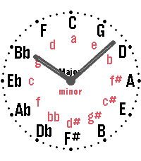
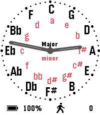
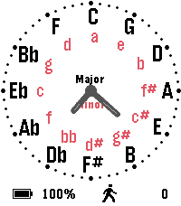
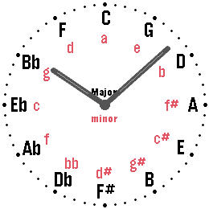
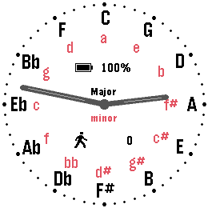
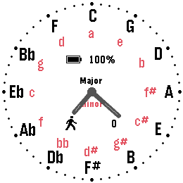

# Circle of Fifths

*The circle of fifths on your wrist.*

     

A Pebble watchface (v1.1.1), available in the [Rebble App Store](https://apps.repebble.com/582ac6cc8c7fff9edf000230).

An analog watchface built around the circle of fifths. The twelve major keys sit around the dial where the hour numbers would be - C at twelve, G at one, D at two and so on clockwise - and the relative minor of each key is set in red just inside it.

Neighbouring keys are a fifth apart, and each major key shares its key signature with the minor key below it. That makes the face a quick reference for transposing, finding related chords or simply learning the circle by heart while you check the time.

Two plain hands, a ring of minute marks and a white face. If you like, it also shows the battery level and today's step count.

The face redraws once a minute and does nothing in between: no second hand, no animation, no weather to fetch and no sensors beyond the step count the watch keeps anyway.

## Settings

- Use shorter hands - halves the hands so they stay clear of the key names.
- Show Battery - the charge level as the watch reports it.
- Show Steps - today's step count from Pebble Health.

## Platforms

- Pebble Time 2 (`emery`)
- Pebble Round 2 (`gabbro`)
- Pebble Time Round (`chalk`)
- Pebble Time (`basalt`)
- Pebble 2 (`diorite`)
- Pebble 2 Duo (`flint`)
- Pebble / Pebble Steel (`aplite`)

## Building

With the [Pebble SDK](https://developer.repebble.com/sdk/):

```bash
pebble build
pebble install --emulator emery
```

The repository can also be imported into CloudPebble as is.

## Release notes

### 1.1.1

The "Use shorter hands" setting is now remembered. Before, the hands went back to full length whenever the watchface restarted - after leaving an app, after an update or after a reboot.

### 1.1.0

Added the newer models and a settings page.

## License

MIT License, see [LICENSE](LICENSE).
